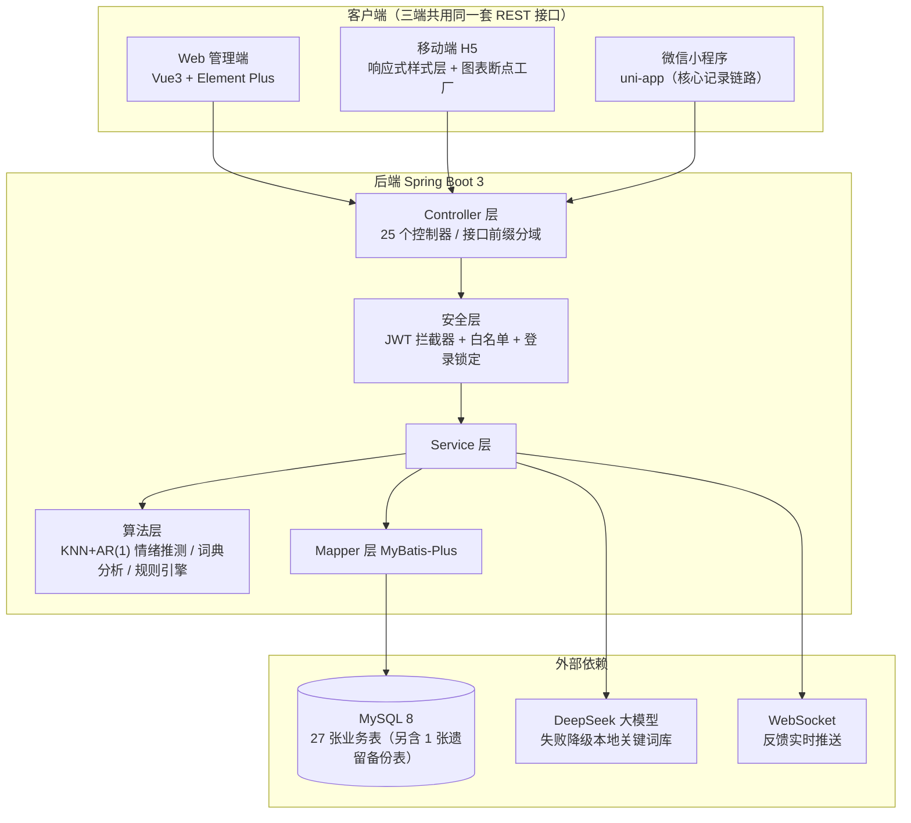

# 绪见 · 个人情绪记录、分析与陪伴平台

> 一个面向个人的长期情绪追踪系统：记录每日心情与日记，做标准化心理测评，听治愈 FM、看心理课程，并由 AI 提供陪伴式对话；在此基础上引入**无感记录**与**情绪风险预警**，把"记录—测评—疏导—分析—预警"串成完整闭环。

**技术栈**：Spring Boot 3 · MyBatis-Plus · MySQL 8 · Vue 3 · Pinia · ECharts 6 · uni-app
**规模**：27 张业务表（另含 1 张遗留备份表） · 25 个 Controller · 250 个 HTTP 接口 · 三端（Web / H5 / 小程序）

---

## 一、为什么做这个项目

现有情绪类工具普遍功能割裂：日记只做记录，测评只出分数，疏导资源与数据分析彼此独立。用户既难以形成对自身情绪的**连续认知**，也无法在情绪持续低落时获得**及时提示**。

本项目要解决的正是这两件事：

| 问题 | 本项目做法 |
|---|---|
| 长期记录门槛高，坚持不下来 | **无感记录**：授权后采集行为特征，推测当日情绪，用户只需确认或驳回 |
| 情绪持续低落无人提醒 | **情绪风险预警**：基于滑动窗口的统计规则识别趋势，输出三级关怀提示 |

---

## 二、系统架构



**一句话概括数据流**：客户端请求 → JWT 拦截器按白名单放行或校验 → Controller 分域路由 → Service 业务处理（复杂部分交给算法层）→ MyBatis-Plus 落库。

---

## 三、功能全景

| 模块 | 能力 |
|---|---|
| **账号与权限** | 注册登录、图形验证码、连续 5 次失败锁定 10 分钟、找回密码、会话管理与踢下线、管理员用户管理（含 Excel 批量导入） |
| **情绪日记** | 撰写/编辑/删除/分页/详情，九类情绪标签，CSV 与 Excel 导出 |
| **无感记录** | 逐项 opt-in 隐私开关、7 维日粒度行为特征、KNN + AR(1) 情绪推测、推测确认与驳回、相关性分析、行为数据导出、隐私操作日志 |
| **情绪风险预警** | 三级判定（轻度关注 / 中度提醒 / 高度关注）、预警列表与概览、标记已读与确认处理、手动触发评估、全程附**非医疗免责声明** |
| **心理测评** | 内置 60 套标准化量表、试卷与题目管理、断点续答、结果分级与成绩查询 |
| **AI 情绪陪伴** | 多会话管理、按会话隔离的上下文重建（最近 10 轮）、单条重新生成、大模型失败降级本地关键词库 |
| **资源中心** | 心理视频 / 治愈 FM / 心理课程，播放量统计、点赞、收藏、评论；评论采用**自动审核**——系统先审，可疑才转人工 |
| **个性化与界面** | 8 套主题色 + 深色模式，用户端与管理端主题**独立记忆**互不影响；图表配色全部跟随主题变量 |
| **数据看板** | 全站 7 项统计 + 个人 7 项统计，含热力图、桑基图、散点图、关键词词云 |
| **反馈与消息** | 工单提交与流转、管理员回复、WebSocket 实时推送 |
| **后台管理** | 15 个管理页面，覆盖用户、内容、测评、预警、词典、隐私审计、系统日志 |

---

## 四、关键设计决策

这几条是项目里真正花过脑子的地方，也是面试/答辩最值得展开讲的部分：

**1. 情绪字典保持单一真源**
九类情绪（1 开心 … 9 其他）及情绪指数映射在前端 4 处、后端 2 处各有一份，历史上出现过前后端映射错位导致统计全错的 Bug。现约定：任何一端改动必须同步其余各处。

**2. KNN 只用人工标注样本训练，避免自我循环**
无感记录的训练样本**只取 `psy_diary.source = 1`（用户手动记录）的日记**。如果用模型自己的推测结果继续训练，误差会逐轮放大形成自循环。置信度低于 0.45 时宁可不推测，也不误导用户。

**3. 统计接口的权限边界**
全站统计（7 个接口）对游客开放，但个人统计必须从 token 取 userId，**Controller 不接收 userId 入参**。新增统计接口时要特别检查，否则会被 `/statistics/**` 通配放行规则意外放开。

**4. 移动端采用渐进式响应式，而非另写一套**
原项目是纯 PC 布局（大量 `min-width`、为悬浮侧栏预留的 `padding-left: 190px`）。逐页重写成本高风险大，改为在 `mobile.css` 统一兜底层按断点解除溢出；图表则用 `setResponsive()` 在跨越断点时**重新生成完整 option**（手机上把图例挪到底部、旋转轴标签）。30+ 个图表零改动适配，桌面端零回归。

**5. 非医疗免责声明三处强制保留**
情绪预警属于高风险功能，免责声明同时存在于：前端弹窗/卡片、后端 `RiskProperties.disclaimer` 配置、论文正文。任何一处缺失都会带来合规风险。

**6. 隐私红线**
无感记录的 Mapper SQL 一律带 `user_id`，Controller 不接 userId 入参，行为 DTO 不含任何文本字段——**管理员也查不到他人行为数据**。隐私审计日志对每次推测保留原始参数（触发方式/推测情绪/置信度），前端做"人话摘要 + 原始串"双层显示，审计可追溯性不打折。

**7. 评论审核：系统先审，可疑才转人工**
UGC 评论若全部人工审核，管理员负担大；若全部机器拦截，又会误杀口语化表达（"emo 了""想润"这类正常倾诉容易被关键词误伤）。方案是三条低误杀判据（可疑词命中、正文超长、短时重复）：干净的直接公开，命中可疑的才进入人工队列。可疑词库在后台可视化维护，修改持久化到 `sys_config` 并即时生效，无需重启。

---

## 五、算法说明

**情绪推测**（`see_you/src/main/java/com/seeyou/see_you/algorithm/`）：

- `EmotionConst`：情绪字典唯一真源
- `EmotionLexiconAnalyzer`：基于情绪词典的文本分析，支持词典热加载
- `BehaviorPredictor`：**加权 KNN（K=5）+ 一阶自回归 AR(1)** 融合。KNN 捕捉"与历史相似日"的情绪，AR(1) 捕捉"近期趋势惯性"，两者加权得到当日推测情绪及概率分布
- `RiskRuleEngine`：滑动窗口（7 天）+ 窗口内低落天数 + 均值/斜率阈值，输出三级预警，同等级带冷却期避免重复打扰

> **选型说明：刻意不使用深度学习。** 个人数据量级下 KNN + 规则引擎可解释性强、可离线运行、零训练成本，且每个判定都能向用户解释清楚——这比黑盒模型更适合"陪伴"场景。

---

## 六、快速开始

```bash
# 1. 数据库
mysql -u root -p -e "CREATE DATABASE see_you DEFAULT CHARACTER SET utf8mb4 COLLATE utf8mb4_unicode_ci;"
# ① 先执行基础表结构，② 再按文件名日期从旧到新执行 see_you/sql/migration/ 下的迁移脚本，
#    ③ 最后执行根目录 3 个初始化数据脚本（顺序不能反，详见 docs/部署说明.md）

# 2. 后端（JDK 17）
cd see_you
cp src/main/resources/application-local.yml.example src/main/resources/application-local.yml  # 填入真实值
mvn package -DskipTests
java -jar target/see_you-0.0.1-SNAPSHOT.jar --server.port=8081

# 3. 前端（Node 18+）
cd frontend
npm install && npm run dev     # http://localhost:5173，已代理 /api 到 8081
```

> 🔐 **仓库不记录任何账号与密码**（本仓库为公开仓库）。管理员 = `sys_user` 表中 `role=1` 的账号，
> 由你自己注册后提权；首次部署请务必设置 ≥12 位强口令，不要使用 `123456`、`111111` 这类字典口令。
> 已有的演示账号请在部署前删除或改密。

> ⚠️ **安全须知**：`application.yml` 只保留占位符，真实凭据放在**已被 Git 忽略**的 `application-local.yml`，或由环境变量注入。详见 `.env.example` 与 `docs/部署说明.md`。

---

## 七、目录结构

```
绪见/
├── frontend/                 # Vue 3 前端（Vite）
│   ├── src/views/            # 用户端页面 12 个 + admin/ 后台页面 15 个
│   ├── src/layouts/          # AppLayout（用户端）/ AdminLayout（后台）
│   ├── src/api/index.js      # 160 个接口封装（单 axios 实例，便于多端复用）
│   ├── src/composables/      # useChart：图表实例托管与断点响应式
│   ├── src/styles/mobile.css # 移动端渐进式响应式兜底层
│   └── src/utils/senseTracker.js  # 无感记录行为埋点
├── see_you/                  # Spring Boot 3 后端
│   └── src/main/java/com/seeyou/see_you/
│       ├── controller/       # 25 个控制器
│       ├── algorithm/        # EmotionConst / EmotionLexiconAnalyzer / BehaviorPredictor / RiskRuleEngine
│       ├── config/           # CORS、JWT 拦截器、WebSocket
│       └── sql/              # 数据库迁移与初始化脚本
├── miniapp/                  # 微信小程序（uni-app）：登录/主页/日记/写日记/AI/我的 6 页
├── deploy/                   # Dockerfile、docker-compose、nginx 配置、一键部署脚本
└── docs/                     # 设计与答辩文档
```

---

## 八、文档索引

| 文档 | 内容 |
|---|---|
| `docs/项目说明-正式版.md` | 完整功能清单与技术原理（论文/正式语气版） |
| `docs/三大模块设计与实现.md` | 无感记录、情绪预警、移动端的方案与论文创新点 |
| `docs/无感记录模块设计.md` | 算法细节与隐私设计 |
| `docs/数据库说明.md` | 27 张业务表结构说明 |
| `docs/架构与接口清单.md` | 系统架构图、ER 图、全量接口清单 |
| `docs/部署说明.md` | 本地与生产部署步骤 |
| `docs/模型评估报告.md` | KNN 情绪推测与预警规则的量化评估 |
| `docs/安全与性能清单.md` | 越权防护、上传安全、索引与性能优化 |
| `docs/安全审计与优化记录.md` | 全量代码审计：P0 越权修复记录与剩余待办清单 |
| `miniapp/README.md` | 小程序端运行方式与设计说明 |
| `docs/小程序端方案.md` | 小程序端技术选型与页面范围 |

---

## 九、测试

```bash
cd see_you
# 数据库凭据通过环境变量注入（仓库里不含任何真实密码）
mvn test -DDB_PASSWORD=你的密码 -DDB_USERNAME=root
```

**100 个测试**，覆盖：账号安全、JWT 工具、统计逻辑、CSV 导出、分页校验、
情绪推测算法（KNN / AR(1) / 融合）、预警规则三级判定，以及**情绪字典跨前后端一致性**
（测试会直接读取 `frontend/src/utils/constants.js` 与后端 `EmotionConst` 比对，
任何一端改漏都会失败——历史上这个错位曾导致全站统计出错）。

另有模型评估报告生成器，跑完会写出 `docs/模型评估报告.md`：

```bash
mvn test -Dtest=ModelEvaluationTest -DDB_PASSWORD=你的密码
```

---

## 十、说明

- 情绪预警功能**不属于医疗诊断**，不能替代专业心理评估，产品内三处均附免责声明。
- 无感记录为**默认关闭的 opt-in 功能**，未授权不采集任何行为数据。
