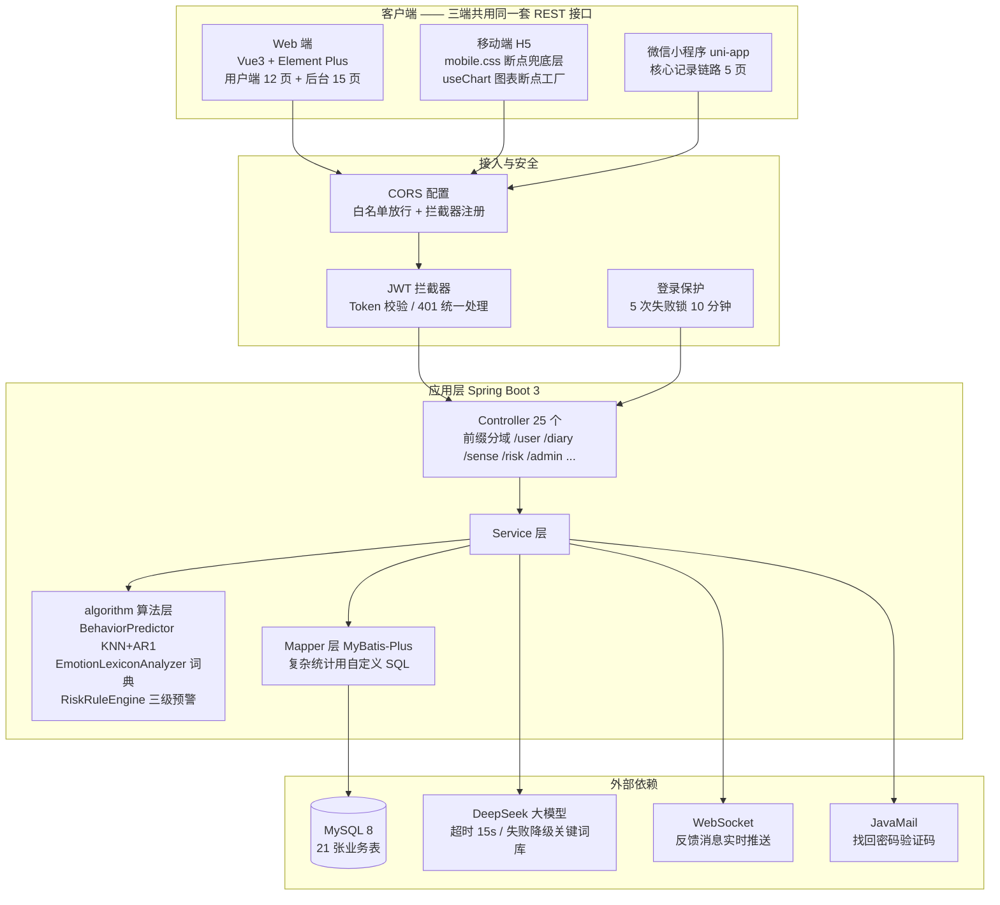

# 绪见 · 架构图、ER 图与接口清单

> 用于答辩讲解与面试介绍。接口清单由脚本从 Controller 源码自动提取（`Temp/gen_api_list.mjs`），与代码同步。

**统计**：25 个 Controller · **210 个 HTTP 接口** · 21 张业务表

---

## 一、系统架构图

### 分层职责

| 层 | 职责 | 关键约定 |
|---|---|---|
| Controller | 路由与参数校验 | **个人类接口不接收 userId 入参**，一律从 token 取，防止越权 |
| Service | 业务逻辑与事务 | 复杂统计聚合下推 MySQL，不在内存里算 |
| algorithm | 情绪推测与预警判定 | 纯函数、可单测、无 IO |
| Mapper | 数据访问 | 无感记录/预警的 SQL 一律带 `user_id` |

---

## 二、ER 图（核心实体关系）

```mermaid
erDiagram
    sys_user ||--o{ psy_diary : "写日记"
    sys_user ||--o{ psy_behavior_feature : "行为特征(无感记录)"
    sys_user ||--o{ psy_emotion_prediction : "情绪推测结果"
    sys_user ||--o{ psy_risk_alert : "情绪预警"
    sys_user ||--o{ psy_test_record : "测评作答"
    sys_user ||--o{ psy_ai_chat : "AI 会话"
    sys_user ||--o{ psy_feedback : "意见反馈"
    sys_user ||--o{ sys_user_session : "登录会话"
    sys_user ||--o{ sys_login_attempt : "登录失败计数"
    sys_user ||--o{ sys_pwd_reset : "找回密码凭证"
    sys_user ||--o{ sys_oauth_bind : "第三方绑定"

    psy_behavior_feature ||--o| psy_emotion_prediction : "生成推测"
    psy_diary ||--o| psy_emotion_prediction : "推测被确认/驳回后回填"

    psy_test ||--o{ psy_test_question : "包含题目"
    psy_test_question ||--o{ psy_test_option : "题目选项"
    psy_test ||--o{ psy_test_record : "作答记录"
    psy_test ||--o{ psy_test_result_grade : "结果分级规则"

    psy_audio ||--o{ psy_history : "播放历史"
    psy_video ||--o{ psy_history : "播放历史"
    psy_audio ||--o{ psy_comment : "评论"
    psy_video ||--o{ psy_comment : "评论"
    psy_audio ||--o{ psy_like : "点赞"
    psy_video ||--o{ psy_collect : "收藏"

    psy_feedback ||--o{ psy_feedback_message : "往来消息"

    sys_user {
        bigint id PK
        varchar username
        varchar password "BCrypt"
        int role "0用户 1管理员"
        int status "0禁用 1正常"
    }
    psy_diary {
        bigint diary_id PK
        bigint user_id FK
        int emotion "1~9 情绪字典"
        date diary_date
        int source "1手动 2推测"
    }
    psy_behavior_feature {
        bigint id PK
        bigint user_id FK
        date feature_date
        decimal active_intensity "7 维特征"
    }
    psy_emotion_prediction {
        bigint id PK
        bigint user_id FK
        int predicted_emotion
        decimal confidence "低于0.45不推荐"
    }
    psy_risk_alert {
        bigint id PK
        bigint user_id FK
        int level "1~3 级"
        date alert_date "uniq user_date"
    }
```

### 表清单（21 张业务表）

| 数据域 | 表 |
|---|---|
| 用户与账号安全 | `sys_user`、`sys_user_session`、`sys_login_attempt`、`sys_pwd_reset`、`sys_oauth_bind` |
| 日记与情绪 | `psy_diary`、`psy_behavior_feature`、`psy_emotion_prediction`、`psy_emotion_lexicon`、`psy_sense_privacy_log` |
| 情绪预警 | `psy_risk_alert` |
| 心理测评 | `psy_test`、`psy_test_question`、`psy_test_option`、`psy_test_record`、`psy_test_result_grade` |
| 媒体资源 | `psy_audio`、`psy_video`、`psy_history` |
| 互动 | `psy_comment`、`psy_like`、`psy_collect` |
| AI 与反馈 | `psy_ai_chat`、`psy_ai_words`、`psy_feedback`、`psy_feedback_message` |
| 其他 | `sys_config`、`psy_banner` |

> 完整字段说明见 `docs/数据库说明.md`。

---

## 三、接口权限矩阵

| 接口域 | 前缀 | 权限 | 说明 |
|---|---|---|---|
| 账号安全 | `/auth/*` | 部分公开 | 验证码、找回密码、会话管理、第三方绑定 |
| 用户 | `/user/*` | 登录 | 登录态从 token 解析 |
| 日记 | `/diary/*` | 登录 | 导出接口限本人 |
| 无感记录 | `/sense/*` | 登录 + opt-in | 未开启开关时返回明确提示而非静默失败 |
| 情绪预警 | `/risk/*` | 登录 | 只返回本人数据 |
| 统计（全站） | `/statistics/{emotion,emotionTrend,...}` | **游客可读** | 7 个接口在拦截器白名单中 |
| 统计（个人） | `/statistics/my/*` | 登录 | userId 只从 token 取 |
| 后台 | `/admin/*` | 管理员 | 服务端 role 校验，不依赖前端缓存 |

---

## 四、全量接口清单

#### AdminManageController  `/admin`  （26 个）

| 方法 | 路径 | 处理方法 | 说明 |
|---|---|---|---|
| GET | `/admin/alert/stats` | alertStats | — |
| GET | `/admin/alert/list` | alertList | — |
| GET | `/admin/alert/{id:\\d+}` | alertDetail | — |
| GET | `/admin/sense/stats` | senseStats | — |
| GET | `/admin/sense/predictions` | sensePredictions | — |
| GET | `/admin/lexicon/stats` | lexiconStats | — |
| GET | `/admin/lexicon/list` | lexiconList | — |
| POST | `/admin/lexicon/save` | lexiconSave | — |
| DELETE | `/admin/lexicon/{id:\\d+}` | lexiconDelete | — |
| POST | `/admin/lexicon/import` | lexiconImport | — |
| GET | `/admin/settings` | settingsGet | — |
| PUT | `/admin/settings` | settingsSave | — |
| POST | `/admin/settings/reset` | settingsReset | — |
| GET | `/admin/aiChat/stats` | aiChatStats | — |
| GET | `/admin/aiChat/users` | aiChatUsers | — |
| GET | `/admin/aiChat/sessions` | aiChatSessions | — |
| GET | `/admin/aiChat/messages` | aiChatMessages | — |
| GET | `/admin/record/stats` | recordStats | — |
| GET | `/admin/record/list` | recordList | — |
| GET | `/admin/security/overview` | securityOverview | — |
| GET | `/admin/security/sessions` | securitySessions | — |
| POST | `/admin/security/kick/{id:\\d+}` | kickSession | — |
| GET | `/admin/security/attempts` | securityAttempts | — |
| POST | `/admin/security/unlock/{id:\\d+}` | unlock | — |
| GET | `/admin/security/resets` | securityResets | — |
| DELETE | `/admin/security/reset/{id:\\d+}` | deleteReset | — |

#### AdminOpsController  `/admin`  （16 个）

| 方法 | 路径 | 处理方法 | 说明 |
|---|---|---|---|
| GET | `/admin/privacy/stats` | privacyStats | — |
| GET | `/admin/privacy/list` | privacyList | — |
| GET | `/admin/user/{id:\\d+}/profile` | userProfile | — |
| GET | `/admin/interaction/stats` | interactionStats | — |
| GET | `/admin/interaction/hot` | interactionHot | — |
| GET | `/admin/interaction/history` | interactionHistory | — |
| GET | `/admin/log/stats` | logStats | — |
| GET | `/admin/log/list` | logList | — |
| POST | `/admin/log/clear` | logClear | — |
| GET | `/admin/banner/list` | bannerList | — |
| POST | `/admin/banner/save` | bannerSave | — |
| POST | `/admin/banner/status/{id:\\d+}` | bannerStatus | — |
| DELETE | `/admin/banner/{id:\\d+}` | bannerDelete | — |
| GET | `/admin/avatar/stats` | avatarStats | — |
| GET | `/admin/avatar/list` | avatarList | — |
| POST | `/admin/avatar/reset` | avatarReset | — |

#### AiChatController  `/aiChat`  （10 个）

| 方法 | 路径 | 处理方法 | 说明 |
|---|---|---|---|
| GET | `/aiChat/session/list` | sessionList | — |
| POST | `/aiChat/session/create` | sessionCreate | — |
| GET | `/aiChat/session/messages` | sessionMessages | — |
| DELETE | `/aiChat/session/{sessionId}` | sessionRemove | — |
| DELETE | `/aiChat/session/{sessionId}/clear` | sessionClear | — |
| DELETE | `/aiChat/{id:\\d+}` | remove | — |
| POST | `/aiChat/{id:\\d+}/regenerate` | regenerate | — |
| POST | `/aiChat/chat` | chat | — |
| GET | `/aiChat/user/list` | getUserList | — |
| GET | `/aiChat/list` | list | — |

#### AuthController  `/auth`  （7 个）

| 方法 | 路径 | 处理方法 | 说明 |
|---|---|---|---|
| GET | `/auth/captcha` | captcha | — |
| GET | `/auth/captcha/dev-code` | captchaDevCode | — |
| POST | `/auth/forgot/send` | forgotSend | 找回密码 |
| POST | `/auth/forgot/reset` | forgotReset | — |
| GET | `/auth/sessions` | sessions | 多设备会话（需登录） |
| DELETE | `/auth/sessions/{sessionId:\\d+}` | kickSession | — |
| DELETE | `/auth/sessions/others` | kickOthers | — |

#### BannerController  `/banner`  （1 个）

| 方法 | 路径 | 处理方法 | 说明 |
|---|---|---|---|
| GET | `/banner/list` | list | — |

#### CommentController  `/comment`  （11 个）

| 方法 | 路径 | 处理方法 | 说明 |
|---|---|---|---|
| GET | `/comment/{id:\\d+}` | getById | — |
| GET | `/comment/list` | list | — |
| GET | `/comment/listByResource` | listByResource | — |
| GET | `/comment/listAllWithUser` | listAllWithUser | — |
| GET | `/comment/my` | my | — |
| POST | `/comment/save` | save | — |
| PUT | `/comment/update` | update | — |
| PUT | `/comment/updateStatus` | updateStatus | — |
| DELETE | `/comment/{id:\\d+}` | remove | — |
| PUT | `/comment/batchUpdateStatus` | batchUpdateStatus | — |
| DELETE | `/comment/batchDelete` | batchDelete | — |

#### DashboardController  `/admin/dashboard`  （1 个）

| 方法 | 路径 | 处理方法 | 说明 |
|---|---|---|---|
| GET | `/admin/dashboard/stats` | getStats | — |

#### FeedbackController  `/feedback`  （10 个）

| 方法 | 路径 | 处理方法 | 说明 |
|---|---|---|---|
| GET | `/feedback/{id}/messages` | getMessages | — |
| GET | `/feedback/{id:\\d+}` | getById | — |
| GET | `/feedback/list` | list | — |
| GET | `/feedback/my` | myList | — |
| POST | `/feedback/save` | save | — |
| PUT | `/feedback/update` | update | — |
| PUT | `/feedback/reply` | reply | — |
| PUT | `/feedback/soft-delete/{id}` | softDelete | — |
| DELETE | `/feedback/{id:\\d+}` | remove | — |
| PUT | `/feedback/supplement` | supplement | — |

#### PsyAiWordsController  `/admin/aiWords`  （7 个）

| 方法 | 路径 | 处理方法 | 说明 |
|---|---|---|---|
| GET | `/admin/aiWords/{id:\\d+}` | getById | — |
| GET | `/admin/aiWords/all` | getAll | 获取所有启用的关键词（前端匹配用） |
| GET | `/admin/aiWords/categories` | getCategories | 获取所有分类 |
| GET | `/admin/aiWords/list` | list | — |
| POST | `/admin/aiWords/save` | save | — |
| PUT | `/admin/aiWords/update` | update | — |
| DELETE | `/admin/aiWords/{id:\\d+}` | remove | — |

#### PsyAudioController  `/audio`  （6 个）

| 方法 | 路径 | 处理方法 | 说明 |
|---|---|---|---|
| GET | `/audio/{id:\\d+}` | getById | — |
| GET | `/audio/list` | list | — |
| POST | `/audio/save` | save | — |
| PUT | `/audio/update` | update | — |
| DELETE | `/audio/{id:\\d+}` | remove | — |
| POST | `/audio/play/{id}` | play | — |

#### PsyDiaryController  `/diary`  （9 个）

| 方法 | 路径 | 处理方法 | 说明 |
|---|---|---|---|
| GET | `/diary/{id:\\d+}` | getById | — |
| GET | `/diary/list` | list | 越权防护：普通用户只能看自己的日记 |
| POST | `/diary/save` | save | — |
| PUT | `/diary/update` | update | — |
| DELETE | `/diary/{id:\\d+}` | remove | — |
| GET | `/diary/whisper` | whisper | — |
| GET | `/diary/admin/list` | adminList | 后台日记管理（管理员） |
| DELETE | `/diary/admin/{id:\\d+}` | adminRemove | — |
| GET | `/diary/export` | exportMine | 数据导出（本人日记 CSV，Excel 友好） |

#### PsyHistoryController  `/history`  （5 个）

| 方法 | 路径 | 处理方法 | 说明 |
|---|---|---|---|
| GET | `/history/{id:\\d+}` | getById | — |
| GET | `/history/list` | list | — |
| POST | `/history/save` | save | 首次写入 / upsert（同 user+resourceType+resourceId 只保留一条，更新 createTime + playProgress） |
| POST | `/history/progress` | updateProgress | 更新播放进度（upsert：不存在则创建） |
| DELETE | `/history/{id:\\d+}` | remove | — |

#### PsyOptionController  `/option`  （5 个）

| 方法 | 路径 | 处理方法 | 说明 |
|---|---|---|---|
| GET | `/option/{id:\\d+}` | getById | — |
| GET | `/option/list` | list | — |
| POST | `/option/save` | save | — |
| PUT | `/option/update` | update | — |
| DELETE | `/option/{id:\\d+}` | remove | — |

#### PsyQuestionController  `/question`  （6 个）

| 方法 | 路径 | 处理方法 | 说明 |
|---|---|---|---|
| GET | `/question/{id:\\d+}` | getById | — |
| GET | `/question/list` | list | — |
| POST | `/question/save` | save | — |
| PUT | `/question/update` | update | — |
| DELETE | `/question/{id:\\d+}` | remove | — |
| POST | `/question/saveWithOptions` | saveWithOptions | — |

#### PsyRecordController  `/record`  （6 个）

| 方法 | 路径 | 处理方法 | 说明 |
|---|---|---|---|
| GET | `/record/grade` | matchGrade | — |
| GET | `/record/{id:\\d+}` | getById | — |
| GET | `/record/list` | list | — |
| POST | `/record/save` | save | — |
| PUT | `/record/update` | update | — |
| DELETE | `/record/{id:\\d+}` | remove | — |

#### PsyResultGradeController  `/admin/resultGrade`  （5 个）

| 方法 | 路径 | 处理方法 | 说明 |
|---|---|---|---|
| GET | `/admin/resultGrade/listByTest` | listByTest | — |
| POST | `/admin/resultGrade/save` | save | — |
| PUT | `/admin/resultGrade/update` | update | — |
| DELETE | `/admin/resultGrade/{id:\\d+}` | remove | — |
| POST | `/admin/resultGrade/batchSave` | batchSave | — |

#### PsyTestPaperController  `/paper`  （6 个）

| 方法 | 路径 | 处理方法 | 说明 |
|---|---|---|---|
| GET | `/paper/{id:\\d+}` | getById | — |
| GET | `/paper/list` | list | — |
| POST | `/paper/save` | save | — |
| PUT | `/paper/update` | update | — |
| DELETE | `/paper/{id:\\d+}` | remove | — |
| PUT | `/paper/updateStatus` | updateStatus | — |

#### PsyVideoController  `/video`  （6 个）

| 方法 | 路径 | 处理方法 | 说明 |
|---|---|---|---|
| GET | `/video/{id:\\d+}` | getById | — |
| GET | `/video/list` | list | — |
| POST | `/video/save` | save | — |
| PUT | `/video/update` | update | — |
| DELETE | `/video/{id:\\d+}` | remove | — |
| POST | `/video/play/{id}` | play | — |

#### RiskAlertController  `/risk`  （6 个）

| 方法 | 路径 | 处理方法 | 说明 |
|---|---|---|---|
| GET | `/risk/latest` | latest | — |
| GET | `/risk/list` | list | — |
| GET | `/risk/overview` | overview | — |
| POST | `/risk/{id:\\d+}/ack` | ack | — |
| POST | `/risk/{id:\\d+}/read` | markRead | — |
| POST | `/risk/evaluate` | evaluate | — |

#### SenseController  `/sense`  （17 个）

| 方法 | 路径 | 处理方法 | 说明 |
|---|---|---|---|
| GET | `/sense/config` | config | 1. 开关 |
| POST | `/sense/config` | updateConfig | — |
| POST | `/sense/behavior/report` | report | — |
| GET | `/sense/behavior/my` | myBehavior | — |
| DELETE | `/sense/behavior` | clearBehavior | — |
| GET | `/sense/behavior/export` | exportBehavior | — |
| GET | `/sense/privacy/logs` | myPrivacyLogs | — |
| GET | `/sense/predict/today` | today | 3. 推测 |
| POST | `/sense/predict/generate` | generate | — |
| POST | `/sense/predict/{id:\\d+}/confirm` | confirm | — |
| POST | `/sense/predict/{id:\\d+}/reject` | reject | — |
| GET | `/sense/predict/history` | history | — |
| GET | `/sense/accuracy` | accuracy | — |
| POST | `/sense/text/analyze` | analyzeText | — |
| GET | `/sense/correlation` | correlation | 5. 可视化数据 |
| GET | `/sense/timeline` | timeline | — |
| POST | `/sense/lexicon/reload` | reloadLexicon | 6. 维护 |

#### StatisticsController  `/statistics`  （16 个）

| 方法 | 路径 | 处理方法 | 说明 |
|---|---|---|---|
| GET | `/statistics/emotion` | emotionStats | — |
| GET | `/statistics/emotionTrend` | emotionTrend | — |
| GET | `/statistics/resource` | resourceStats | — |
| GET | `/statistics/testResult` | testResultStats | — |
| GET | `/statistics/overview` | overview | — |
| GET | `/statistics/videoRank` | videoRank | — |
| GET | `/statistics/activeUsers` | activeUsers | — |
| GET | `/statistics/my/overview` | myOverview | — |
| GET | `/statistics/my/trend` | myTrend | — |
| GET | `/statistics/my/heatmap` | myHeatmap | — |
| GET | `/statistics/my/emotion` | myEmotion | — |
| GET | `/statistics/my/testTrend` | myTestTrend | — |
| GET | `/statistics/my/monthly` | myMonthly | — |
| GET | `/statistics/my/scatter` | myScatter | C. 进阶图表（Step 3） |
| GET | `/statistics/my/sankey` | mySankey | — |
| GET | `/statistics/my/keywords` | myKeywords | — |

#### SysUserController  `/user`  （12 个）

| 方法 | 路径 | 处理方法 | 说明 |
|---|---|---|---|
| POST | `/user/login` | login | — |
| GET | `/user/info` | info | — |
| GET | `/user/{id:\\d+}` | getById | — |
| GET | `/user/list` | list | 敏感字段不下发：密码哈希/密保等一律抹掉，避免任意登录用户枚举他人账号信息 |
| POST | `/user/register` | register | — |
| PUT | `/user/update` | update | — |
| PUT | `/user/deactivate` | deactivate | — |
| PUT | `/user/changePassword` |  | — |
| PUT | `/user/status` | updateStatus | — |
| DELETE | `/user/{id:\\d+}` | delete | — |
| GET | `/user/import/template` | downloadTemplate | — |
| POST | `/user/import` | importUsers | — |

#### UploadController  `/upload`  （2 个）

| 方法 | 路径 | 处理方法 | 说明 |
|---|---|---|---|
| POST | `/upload/file` | upload | — |
| GET | `/upload/list` | listFiles | — |

#### UserCollectController  `/collect`  （7 个）

| 方法 | 路径 | 处理方法 | 说明 |
|---|---|---|---|
| GET | `/collect/{id:\\d+}` | getById | — |
| GET | `/collect/list` | list | — |
| POST | `/collect/save` | save | — |
| DELETE | `/collect/{id:\\d+}` | remove | — |
| DELETE | `/collect/removeByResource` | removeByResource | — |
| GET | `/collect/count` | count | — |
| GET | `/collect/check` | check | — |

#### UserLikeController  `/like`  （7 个）

| 方法 | 路径 | 处理方法 | 说明 |
|---|---|---|---|
| GET | `/like/{id:\\d+}` | getById | — |
| GET | `/like/list` | list | — |
| POST | `/like/save` | save | — |
| DELETE | `/like/{id:\\d+}` | remove | — |
| DELETE | `/like/removeByResource` | removeByResource | — |
| GET | `/like/count` | count | — |
| GET | `/like/check` | check | — |
