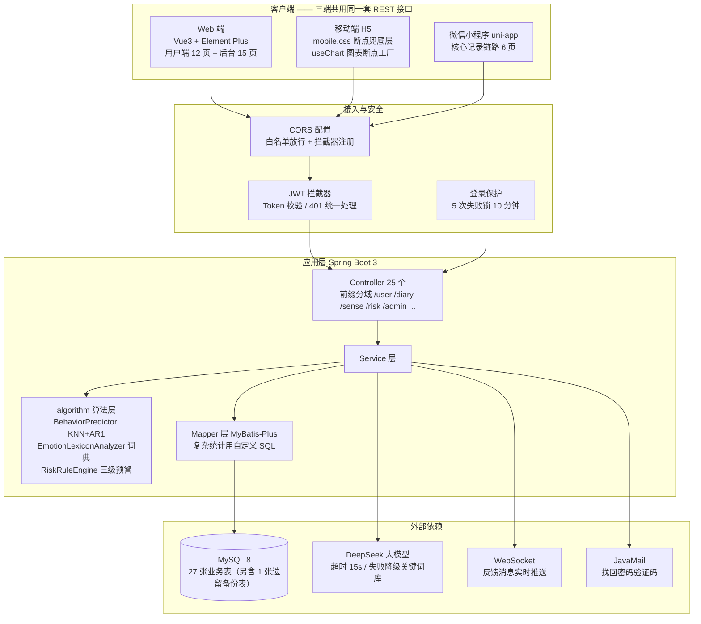
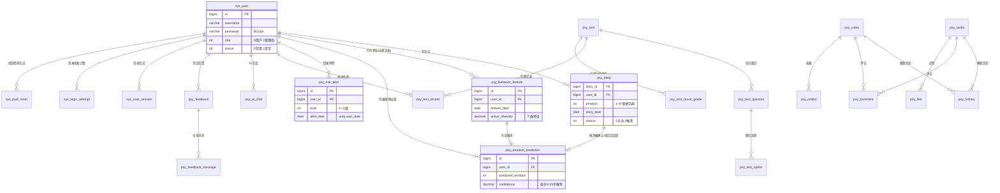

# 绪见 · 架构图、ER 图与接口清单

> 用于答辩讲解与面试介绍。接口清单由脚本从 Controller 源码自动提取（`scripts/gen_api_list.mjs`），与代码同步，改接口后重跑即可。

**统计**：25 个 Controller · **250 个 HTTP 接口** · 27 张业务表（另含 1 张遗留备份表）

---

## 一、系统架构图

### 分层职责

| 层 | 职责 | 关键约定 |
|---|---|---|
| Controller | 路由与参数校验 | **个人类接口不接收 userId 入参**，一律从 token 取，防止越权 |
| Service | 业务逻辑与事务 | 复杂统计聚合下推 MySQL，不在内存里算 |
| algorithm | 情绪推测与预警判定 | 纯函数、可单测、无 IO |
| Mapper | 数据访问 | 无感记录/预警的 SQL 一律带 `user_id` |

---

## 二、ER 图（核心实体关系）

### 表清单（27 张业务表 + 1 张遗留备份表 `psy_ai_chat_bak_20261010`）

| 数据域 | 表 |
|---|---|
| 用户与账号安全 | `sys_user`、`sys_user_session`、`sys_login_attempt`、`sys_pwd_reset` |
| 日记与情绪 | `psy_diary`、`psy_behavior_feature`、`psy_emotion_prediction`、`psy_emotion_lexicon`、`psy_sense_privacy_log` |
| 情绪预警 | `psy_risk_alert` |
| 心理测评 | `psy_test`、`psy_test_question`、`psy_test_option`、`psy_test_record`、`psy_test_result_grade` |
| 媒体资源 | `psy_audio`、`psy_video`、`psy_history` |
| 互动 | `psy_comment`、`psy_like`、`psy_collect` |
| AI 与反馈 | `psy_ai_chat`、`psy_ai_words`、`psy_feedback`、`psy_feedback_message` |
| 其他 | `sys_config`、`psy_banner` |

> 完整字段说明见 `docs/数据库说明.md`。

---

## 三、接口权限矩阵

| 接口域 | 前缀 | 权限 | 说明 |
|---|---|---|---|
| 账号安全 | `/auth/*` | 部分公开 | 验证码、找回密码、会话管理 |
| 用户 | `/user/*` | 登录 | 登录态从 token 解析 |
| 日记 | `/diary/*` | 登录 | 导出接口限本人 |
| 无感记录 | `/sense/*` | 登录 + opt-in | 未开启开关时返回明确提示而非静默失败 |
| 情绪预警 | `/risk/*` | 登录 | 只返回本人数据 |
| 统计（全站） | `/statistics/{emotion,emotionTrend,...}` | **游客可读** | 7 个接口在拦截器白名单中 |
| 统计（个人） | `/statistics/my/*` | 登录 | userId 只从 token 取 |
| 后台 | `/admin/*` | 管理员 | 服务端 role 校验，不依赖前端缓存 |

---

## 四、全量接口清单

#### AdminManageController  `/admin`  （36 个）

| 方法 | 路径 | 处理方法 | 说明 |
|---|---|---|---|
| ANY | `/admin/admin` |  | — |
| GET | `/admin/alert/stats` | alertStats | * 预警统计：总数 / 未读 / 未确认 / 三级分布 / 近 30 天趋势 */ |
| GET | `/admin/alert/list` | alertList | * 预警记录分页（带用户名，可按等级 / 是否已读筛选） */ |
| GET | `/admin/alert/export` | exportAlerts | * |
| POST | `/admin/alert/{id:\\d+}/read` | markAlertRead | * 管理员查看判定依据 → 状态记为已读（「已读 = 被查看」：用户端弹窗或管理员查看，任一方都算） */ |
| GET | `/admin/alert/{id:\\d+}` | alertDetail | * 预警详情：只给统计指标（不含日记正文与行为明细） */ |
| POST | `/admin/alert/{id:\\d+}/disposition` | disposition | * |
| GET | `/admin/sense/stats` | senseStats | * 无感记录统计：开启率、推测量、采纳率、平均置信度、近 14 天趋势、九类分布 */ |
| GET | `/admin/sense/predictions` | sensePredictions | * 推测记录分页（剔除特征快照等明细字段） */ |
| GET | `/admin/lexicon/stats` | lexiconStats | * 词典统计：总数 + 按情绪分组 + 按类型分组 */ |
| GET | `/admin/lexicon/list` | lexiconList | * 词典分页查询 */ |
| POST | `/admin/lexicon/save` | lexiconSave | * 新增 / 修改词条（有 lexiconId 即更新） */ |
| DELETE | `/admin/lexicon/{id:\\d+}` | lexiconDelete | * 删除词条 */ |
| POST | `/admin/lexicon/import` | lexiconImport | * 批量导入：每行一条，支持「词,情绪,权重,类型」或「词 情绪」，# 开头为注释 */ |
| GET | `/admin/alert/words` | alertWords | * 词库列表 */ |
| POST | `/admin/alert/words` | alertWordAdd | * 新增词条 */ |
| POST | `/admin/alert/words/delete` | alertWordDelete | * 删除词条。用 POST + body 而不是 DELETE + 路径：词条是中文，拼进 URL 要转义，body 更干净 */ |
| GET | `/admin/comment/words` | commentWords | * 评论审核设置：开关 + 可疑词库 */ |
| POST | `/admin/comment/words` | commentWordAdd | * 新增可疑词条（命中即转人工） */ |
| POST | `/admin/comment/words/delete` | commentWordDelete | * 删除可疑词条（body 传词，避免中文拼 URL 转义） */ |
| GET | `/admin/settings` | settingsGet | ================================================================== |
| PUT | `/admin/settings` | settingsSave | — |
| POST | `/admin/settings/reset` | settingsReset | * 恢复默认：group 为空表示全部 */ |
| GET | `/admin/aiChat/stats` | aiChatStats | * AI 对话总览：消息数、会话数、活跃用户、近 7 天趋势 */ |
| GET | `/admin/aiChat/users` | aiChatUsers | * 按用户聚合的对话列表 */ |
| GET | `/admin/aiChat/sessions` | aiChatSessions | * 某用户的会话列表 */ |
| GET | `/admin/aiChat/messages` | aiChatMessages | * 某个会话的消息明细（内容安全审计用） */ |
| GET | `/admin/record/stats` | recordStats | ================================================================== |
| GET | `/admin/record/list` | recordList | — |
| GET | `/admin/security/overview` | securityOverview | ================================================================== |
| GET | `/admin/security/sessions` | securitySessions | * 在线会话（token 脱敏） */ |
| POST | `/admin/security/kick/{id:\\d+}` | kickSession | * 强制下线 */ |
| GET | `/admin/security/attempts` | securityAttempts | * 登录失败锁定记录 */ |
| POST | `/admin/security/unlock/{id:\\d+}` | unlock | * 解锁：清掉失败记录 */ |
| GET | `/admin/security/resets` | securityResets | * 密码找回申请（不返回验证码） */ |
| DELETE | `/admin/security/reset/{id:\\d+}` | deleteReset | * 删除一条找回申请（通常是用户找回成功后清理） */ |

#### AdminOpsController  `/admin`  （17 个）

| 方法 | 路径 | 处理方法 | 说明 |
|---|---|---|---|
| ANY | `/admin/admin` |  | — |
| GET | `/admin/privacy/stats` | privacyStats | * 隐私审计统计：总量 / 今日 / 涉及用户 / 动作分布 / 近 14 天趋势 */ |
| GET | `/admin/privacy/list` | privacyList | * 隐私审计日志列表（支持按动作、用户筛选） */ |
| GET | `/admin/user/{id:\\d+}/profile` | userProfile | * 单个用户的完整画像：日记 / 测评 / 预警 / 无感 / 安全 / 互动 六维汇总 */ |
| GET | `/admin/interaction/stats` | interactionStats | * 互动总览：点赞 / 收藏 / 浏览 / 完播率 / 活跃用户 */ |
| GET | `/admin/interaction/hot` | interactionHot | * 热门内容 Top10：按「点赞数 + 收藏数」加权排序 */ |
| GET | `/admin/interaction/history` | interactionHistory | * 浏览/播放记录分页 */ |
| GET | `/admin/log/stats` | logStats | ================================================================== |
| GET | `/admin/log/list` | logList | — |
| POST | `/admin/log/clear` | logClear | — |
| GET | `/admin/banner/list` | bannerList | ================================================================== |
| POST | `/admin/banner/save` | bannerSave | — |
| POST | `/admin/banner/status/{id:\\d+}` | bannerStatus | — |
| DELETE | `/admin/banner/{id:\\d+}` | bannerDelete | — |
| GET | `/admin/avatar/stats` | avatarStats | * 头像审核概览：用户总数 / 自定义头像数 / 内置头像数 / 累计重置次数 */ |
| GET | `/admin/avatar/list` | avatarList | * 自定义头像用户列表（支持用户名/昵称模糊搜索，分页） */ |
| POST | `/admin/avatar/reset` | avatarReset | — |

#### AiChatController  `/aiChat`  （11 个）

| 方法 | 路径 | 处理方法 | 说明 |
|---|---|---|---|
| ANY | `/aiChat/aiChat` |  | — |
| GET | `/aiChat/session/list` | sessionList | * |
| POST | `/aiChat/session/create` | sessionCreate | * |
| GET | `/aiChat/session/messages` | sessionMessages | * |
| DELETE | `/aiChat/session/{sessionId}` | sessionRemove | * |
| DELETE | `/aiChat/session/{sessionId}/clear` | sessionClear | * |
| DELETE | `/aiChat/{id:\\d+}` | remove | * |
| POST | `/aiChat/{id:\\d+}/regenerate` | regenerate | * |
| POST | `/aiChat/chat` | chat | * |
| GET | `/aiChat/user/list` | getUserList | * |
| GET | `/aiChat/list` | list | * |

#### AuthController  `/auth`  （8 个）

| 方法 | 路径 | 处理方法 | 说明 |
|---|---|---|---|
| ANY | `/auth/auth` |  | — |
| GET | `/auth/captcha` | captcha | * 获取图形验证码 */ |
| GET | `/auth/captcha/dev-code` | captchaDevCode | * 开发模式查看验证码答案（app.dev-captcha-log=true 时可用） */ |
| POST | `/auth/forgot/send` | forgotSend | ============ 找回密码 ============ |
| POST | `/auth/forgot/reset` | forgotReset | — |
| GET | `/auth/sessions` | sessions | ============ 多设备会话（需登录） ============ |
| DELETE | `/auth/sessions/{sessionId:\\d+}` | kickSession | — |
| DELETE | `/auth/sessions/others` | kickOthers | — |

#### BannerController  `/banner`  （2 个）

| 方法 | 路径 | 处理方法 | 说明 |
|---|---|---|---|
| ANY | `/banner/banner` |  | — |
| GET | `/banner/list` | list | * |

#### CommentController  `/comment`  （12 个）

| 方法 | 路径 | 处理方法 | 说明 |
|---|---|---|---|
| ANY | `/comment/comment` |  | — |
| GET | `/comment/{id:\\d+}` | getById | — |
| GET | `/comment/list` | list | — |
| GET | `/comment/listByResource` | listByResource | — |
| GET | `/comment/listAllWithUser` | listAllWithUser | — |
| GET | `/comment/my` | my | * |
| POST | `/comment/save` | save | * |
| PUT | `/comment/update` | update | — |
| PUT | `/comment/updateStatus` | updateStatus | * |
| DELETE | `/comment/{id:\\d+}` | remove | — |
| PUT | `/comment/batchUpdateStatus` | batchUpdateStatus | * |
| DELETE | `/comment/batchDelete` | batchDelete | * |

#### DashboardController  `/admin/dashboard`  （2 个）

| 方法 | 路径 | 处理方法 | 说明 |
|---|---|---|---|
| ANY | `/admin/dashboard/admin/dashboard` |  | — |
| GET | `/admin/dashboard/stats` | getStats | * |

#### FeedbackController  `/feedback`  （11 个）

| 方法 | 路径 | 处理方法 | 说明 |
|---|---|---|---|
| ANY | `/feedback/feedback` |  | — |
| GET | `/feedback/{id}/messages` | getMessages | * 🆕 获取某条反馈的完整聊天记录 */ |
| GET | `/feedback/{id:\\d+}` | getById | — |
| GET | `/feedback/list` | list | * 列表（带用户名）- 支持按 userId 过滤 + keyword 搜索 + 时间范围 */ |
| GET | `/feedback/my` | myList | * |
| POST | `/feedback/save` | save | * 用户提交反馈 |
| PUT | `/feedback/update` | update | * 通用更新（状态/内容） */ |
| PUT | `/feedback/reply` | reply | * 管理员回复（专门接口，同时把状态改成已完成） */ |
| PUT | `/feedback/soft-delete/{id}` | softDelete | * 🆕 用户端软删除（deleted=1，后台还能看到） */ |
| DELETE | `/feedback/{id:\\d+}` | remove | * 管理员硬删除（含往来消息，事务保证） */ |
| PUT | `/feedback/supplement` | supplement | * 用户补充回复（回复管理员） |

#### PsyAiWordsController  `/admin/aiWords`  （8 个）

| 方法 | 路径 | 处理方法 | 说明 |
|---|---|---|---|
| ANY | `/admin/aiWords/admin/aiWords` |  | — |
| GET | `/admin/aiWords/{id:\\d+}` | getById | — |
| GET | `/admin/aiWords/all` | getAll | 获取所有启用的关键词（前端匹配用） |
| GET | `/admin/aiWords/categories` | getCategories | 获取所有分类 |
| GET | `/admin/aiWords/list` | list | — |
| POST | `/admin/aiWords/save` | save | — |
| PUT | `/admin/aiWords/update` | update | — |
| DELETE | `/admin/aiWords/{id:\\d+}` | remove | — |

#### PsyAudioController  `/audio`  （7 个）

| 方法 | 路径 | 处理方法 | 说明 |
|---|---|---|---|
| ANY | `/audio/audio` |  | — |
| GET | `/audio/{id:\\d+}` | getById | — |
| GET | `/audio/list` | list | — |
| POST | `/audio/save` | save | — |
| PUT | `/audio/update` | update | — |
| DELETE | `/audio/{id:\\d+}` | remove | — |
| POST | `/audio/play/{id}` | play | — |

#### PsyDiaryController  `/diary`  （13 个）

| 方法 | 路径 | 处理方法 | 说明 |
|---|---|---|---|
| ANY | `/diary/diary` |  | — |
| GET | `/diary/{id:\\d+}` | getById | — |
| GET | `/diary/list` | list | — |
| POST | `/diary/save` | save | — |
| PUT | `/diary/update` | update | — |
| GET | `/diary/sleep/week` | sleepWeek | * 近 7 天每天的日记数与现有 sleep_hours（供补录弹窗预填；预填取该天最后一篇的非空值） */ |
| POST | `/diary/sleep/batch` | sleepBatch | * |
| PUT | `/diary/{id:\\d+}/claim` | claim | * |
| DELETE | `/diary/{id:\\d+}` | remove | — |
| GET | `/diary/whisper` | whisper | — |
| GET | `/diary/admin/list` | adminList | * 管理员分页查看全站日记（keyword 搜正文，userId 过滤某用户） */ |
| DELETE | `/diary/admin/{id:\\d+}` | adminRemove | * 管理员删除违规日记 */ |
| GET | `/diary/export` |  | * 导出我的全部日记为 CSV（带 BOM，Excel 直接打开不乱码） */ |

#### PsyHistoryController  `/history`  （6 个）

| 方法 | 路径 | 处理方法 | 说明 |
|---|---|---|---|
| ANY | `/history/history` |  | — |
| GET | `/history/{id:\\d+}` | getById | — |
| GET | `/history/list` | list | — |
| POST | `/history/save` | save | 首次写入 / upsert（同 user+resourceType+resourceId 只保留一条，更新 createTime + playProgress） |
| POST | `/history/progress` | updateProgress | 更新播放进度（upsert：不存在则创建） |
| DELETE | `/history/{id:\\d+}` | remove | — |

#### PsyOptionController  `/option`  （6 个）

| 方法 | 路径 | 处理方法 | 说明 |
|---|---|---|---|
| ANY | `/option/option` |  | — |
| GET | `/option/{id:\\d+}` | getById | — |
| GET | `/option/list` | list | — |
| POST | `/option/save` | save | — |
| PUT | `/option/update` | update | — |
| DELETE | `/option/{id:\\d+}` | remove | — |

#### PsyQuestionController  `/question`  （7 个）

| 方法 | 路径 | 处理方法 | 说明 |
|---|---|---|---|
| ANY | `/question/question` |  | — |
| GET | `/question/{id:\\d+}` | getById | — |
| GET | `/question/list` | list | — |
| POST | `/question/save` | save | — |
| PUT | `/question/update` | update | — |
| DELETE | `/question/{id:\\d+}` | remove | — |
| POST | `/question/saveWithOptions` | saveWithOptions | * |

#### PsyRecordController  `/record`  （7 个）

| 方法 | 路径 | 处理方法 | 说明 |
|---|---|---|---|
| ANY | `/record/record` |  | — |
| GET | `/record/grade` | matchGrade | * |
| GET | `/record/{id:\\d+}` | getById | — |
| GET | `/record/list` | list | — |
| POST | `/record/save` | save | — |
| PUT | `/record/update` | update | — |
| DELETE | `/record/{id:\\d+}` | remove | — |

#### PsyResultGradeController  `/admin/resultGrade`  （6 个）

| 方法 | 路径 | 处理方法 | 说明 |
|---|---|---|---|
| ANY | `/admin/resultGrade/admin/resultGrade` |  | — |
| GET | `/admin/resultGrade/listByTest` | listByTest | * |
| POST | `/admin/resultGrade/save` | save | * |
| PUT | `/admin/resultGrade/update` | update | * |
| DELETE | `/admin/resultGrade/{id:\\d+}` | remove | * |
| POST | `/admin/resultGrade/batchSave` | batchSave | * |

#### PsyTestPaperController  `/paper`  （7 个）

| 方法 | 路径 | 处理方法 | 说明 |
|---|---|---|---|
| ANY | `/paper/paper` |  | — |
| GET | `/paper/{id:\\d+}` | getById | — |
| GET | `/paper/list` | list | — |
| POST | `/paper/save` | save | — |
| PUT | `/paper/update` | update | — |
| DELETE | `/paper/{id:\\d+}` | remove | — |
| PUT | `/paper/updateStatus` | updateStatus | * |

#### PsyVideoController  `/video`  （7 个）

| 方法 | 路径 | 处理方法 | 说明 |
|---|---|---|---|
| ANY | `/video/video` |  | — |
| GET | `/video/{id:\\d+}` | getById | — |
| GET | `/video/list` | list | — |
| POST | `/video/save` | save | — |
| PUT | `/video/update` | update | — |
| DELETE | `/video/{id:\\d+}` | remove | — |
| POST | `/video/play/{id}` | play | — |

#### RiskAlertController  `/risk`  （9 个）

| 方法 | 路径 | 处理方法 | 说明 |
|---|---|---|---|
| ANY | `/risk/risk` |  | — |
| GET | `/risk/admin-stream` | adminStream | * |
| GET | `/risk/latest` | latest | * 最近一条未确认预警（登录后弹窗用） */ |
| GET | `/risk/list` | list | * 历史预警记录（分页） */ |
| GET | `/risk/overview` | overview | * 概览：未读数 / 累计次数 / 最高等级 / 当前阈值 */ |
| POST | `/risk/{id:\\d+}/ack` | ack | * 用户点「我知道了」 */ |
| POST | `/risk/{id:\\d+}/read` | markRead | * 标记已读 */ |
| POST | `/risk/{id:\\d+}/misreport` | markMisreport | * |
| POST | `/risk/evaluate` | evaluate | * |

#### SenseController  `/sense`  （19 个）

| 方法 | 路径 | 处理方法 | 说明 |
|---|---|---|---|
| ANY | `/sense/sense` |  | — |
| GET | `/sense/config` | config | ==================== 1. 开关 ==================== |
| POST | `/sense/config` | updateConfig | — |
| POST | `/sense/behavior/report` | report | * |
| GET | `/sense/behavior/my` | myBehavior | * 我的行为数据（自查用） */ |
| DELETE | `/sense/behavior` | clearBehavior | * 一键清空我的全部行为数据（数据可撤回权） */ |
| GET | `/sense/behavior/export` |  | * 导出我的行为数据 CSV（数据可携带权） */ |
| GET | `/sense/privacy/logs` | myPrivacyLogs | * 我的隐私操作日志（证明"我的数据我可控"） */ |
| GET | `/sense/predict/today` | today | * 今日待确认推测 */ |
| POST | `/sense/predict/generate` | generate | * 主动触发一次推测（用户点「帮我猜一下」） */ |
| POST | `/sense/predict/{id:\\d+}/confirm` | confirm | * 采用推测 → 生成正式日记(source=2) */ |
| POST | `/sense/predict/{id:\\d+}/reject` | reject | * 忽略该推测 */ |
| POST | `/sense/auto-fill` | autoFill | * |
| GET | `/sense/predict/history` | history | — |
| GET | `/sense/accuracy` | accuracy | * 命中率统计（论文实验数据来源） */ |
| POST | `/sense/text/analyze` | analyzeText | * |
| GET | `/sense/correlation` | correlation | * 特征-情绪关联（散点 / 热力 / 雷达） */ |
| GET | `/sense/timeline` | timeline | * 手动录入 vs 系统推测 双序列 */ |
| POST | `/sense/lexicon/reload` | reloadLexicon | * 重新加载词典（后台改词之后调用） */ |

#### StatisticsController  `/statistics`  （17 个）

| 方法 | 路径 | 处理方法 | 说明 |
|---|---|---|---|
| ANY | `/statistics/statistics` |  | — |
| GET | `/statistics/emotion` | emotionStats | * 1. 全站情绪分布（柱状图） */ |
| GET | `/statistics/emotionTrend` | emotionTrend | * |
| GET | `/statistics/resource` | resourceStats | * 3. 资源分类统计（饼图） */ |
| GET | `/statistics/testResult` | testResultStats | * 4. 测评结果情绪分布（饼图） */ |
| GET | `/statistics/overview` | overview | * 5. 全站概览（数字卡片）—— 本来就是 SQL COUNT(*)，保持原样 */ |
| GET | `/statistics/videoRank` | videoRank | * 6. 视频播放排行（横向条形图） */ |
| GET | `/statistics/activeUsers` | activeUsers | * 7. 最近活跃用户（写日记最多的前 5 人） */ |
| GET | `/statistics/my/overview` | myOverview | * |
| GET | `/statistics/my/trend` | myTrend | * |
| GET | `/statistics/my/heatmap` | myHeatmap | * |
| GET | `/statistics/my/emotion` | myEmotion | * B4. 我的情绪分布（饼图 / 柱状图） */ |
| GET | `/statistics/my/testTrend` | myTestTrend | * |
| GET | `/statistics/my/monthly` | myMonthly | * B6. 我的月度统计（近 N 个月平均情绪指数 + 记录数） */ |
| GET | `/statistics/my/scatter` | myScatter | * C1. 我的「睡眠时长 x 情绪指数」散点样本（近 90 天，最多 500 条；回归线由前端最小二乘计算） */ |
| GET | `/statistics/my/sankey` | mySankey | * C2. 我的「星期 x 情绪」桑基流向（近 90 天）：node=周一~周日 + 9 种情绪，link=出现次数 */ |
| GET | `/statistics/my/keywords` | myKeywords | * C3. 我的日记高频词（词云用）：近 180 天正文做中文二元切分 + 停用字过滤，返回前 40 个 */ |

#### SysUserController  `/user`  （13 个）

| 方法 | 路径 | 处理方法 | 说明 |
|---|---|---|---|
| ANY | `/user/user` |  | — |
| POST | `/user/login` | login | — |
| GET | `/user/info` | info | * |
| GET | `/user/{id:\\d+}` | getById | — |
| GET | `/user/list` | list | — |
| POST | `/user/register` | register | — |
| PUT | `/user/update` | update | * 更新用户（编辑资料） |
| PUT | `/user/deactivate` | deactivate | * 注销账号（需密码二次确认）：账号匿名化并停用，所有设备立即下线 */ |
| PUT | `/user/changePassword` |  | — |
| PUT | `/user/status` | updateStatus | * 单独改状态（启用/禁用） */ |
| DELETE | `/user/{id:\\d+}` | delete | * 删除用户 */ |
| GET | `/user/import/template` | downloadTemplate | * |
| POST | `/user/import` | importUsers | * |

#### UploadController  `/upload`  （3 个）

| 方法 | 路径 | 处理方法 | 说明 |
|---|---|---|---|
| ANY | `/upload/upload` |  | — |
| POST | `/upload/file` | upload | — |
| GET | `/upload/list` | listFiles | * |

#### UserCollectController  `/collect`  （8 个）

| 方法 | 路径 | 处理方法 | 说明 |
|---|---|---|---|
| ANY | `/collect/collect` |  | — |
| GET | `/collect/{id:\\d+}` | getById | — |
| GET | `/collect/list` | list | — |
| POST | `/collect/save` | save | — |
| DELETE | `/collect/{id:\\d+}` | remove | — |
| DELETE | `/collect/removeByResource` | removeByResource | * |
| GET | `/collect/count` | count | * |
| GET | `/collect/check` | check | * |

#### UserLikeController  `/like`  （8 个）

| 方法 | 路径 | 处理方法 | 说明 |
|---|---|---|---|
| ANY | `/like/like` |  | — |
| GET | `/like/{id:\\d+}` | getById | — |
| GET | `/like/list` | list | — |
| POST | `/like/save` | save | — |
| DELETE | `/like/{id:\\d+}` | remove | — |
| DELETE | `/like/removeByResource` | removeByResource | * |
| GET | `/like/count` | count | * |
| GET | `/like/check` | check | * |
